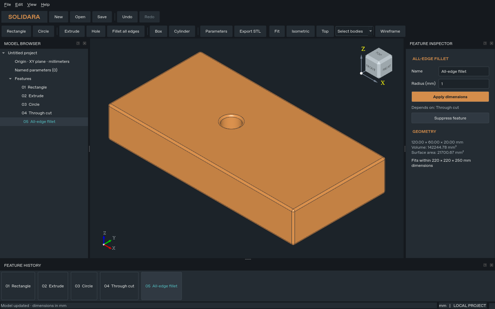

# Solidara

Solidara is an offline, native CAD application for making functional parts. This early development release uses C++20, Qt 6 Widgets, and Open CASCADE for exact geometry. Windows 10/11 x64 is the target platform; the current implementation is built and tested on Linux.



## Working modeling slice

- Dimensioned rectangle and circle profiles on planes parallel to XY.
- Extrusion, boxes, cylinders, circular through-holes, and all-edge fillets.
- Editable feature history, stable feature identifiers, dependency regeneration, named length expressions, and undo/redo.
- Transactional edits: invalid dimensions, broken references, and failed geometry leave the previous model intact.
- Versioned `.solidara` project files with atomic saving and editable reconstruction on open.
- Binary/ASCII STL and STEP export in the core; binary STL with adjustable chord tolerance and STEP export in the UI. STEP read-back is tested in the core.
- Native OCCT viewport with orbit, pan, zoom, standard views, orientation cube, wireframe, perspective, hover highlighting, and body/face/edge/vertex selection.
- Copper-accented desktop theme, dockable browser/inspector/history, tooltips, persistent panel layout, and bundled offline help.
- Bounding dimensions, volume, surface area, and a basic fixed print-volume dimension check.

No runtime accounts, network services, telemetry, or downloaded assets are used.

## Build and run

On the Debian 13 x64 cloud environment, from this checkout:

```bash
bash scripts/bootstrap-linux.sh
source scripts/env-linux.sh
cmake --preset linux-debug
cmake --build --preset linux-debug
ctest --preset linux-debug
./build/linux-debug/Solidara
```

A desktop display is needed for interactive use. For automated GUI validation:

```bash
source scripts/env-linux.sh
xvfb-run -a -s '-screen 0 1440x900x24' \
  ./build/linux-debug/Solidara --smoke-test ./build/gui-smoke
```

[Windows and system-package build instructions](docs/development/BUILD.md) include the pinned vcpkg setup, release preset, and portable ZIP packaging. Windows execution and packaging remain unverified until run on Windows.

## First part

1. Create a rectangle: width 100, depth 60, origin 0/0/0; finish the profile.
2. Select it and extrude by 20 mm.
3. Add a through-hole: radius 5, X 50, Y 30.
4. Optionally apply an all-edge fillet of 1 mm.
5. Select the original rectangle and change its width to 120; apply dimensions.
6. Save the `.solidara` file, reopen it, and export STL for printing or STEP for CAD interchange.

An editable [example mounting plate](examples/mounting-plate.solidara) is included.

Use right drag to orbit, middle drag to pan, the wheel to zoom, F to fit, and F1 for offline help. Select earlier features to inspect their intermediate geometry. Exports use the final solid, regardless of the feature being viewed.

## Scope and limitations

This is a functioning initial slice, not a Fusion 360 replacement. Profiles are exact dimensioned templates entered through dialogs; freehand sketch drawing and a general numerical constraint solver are not implemented. Circle attachment uses a body's upper bounding plane, not persistent selected-face references. Fillets affect all edges. Modeling follows one final-body history; multi-body management and assemblies are not available.

Other outstanding work includes revolve/sweep/loft, union/intersection UI, individual-edge fillets, arbitrary construction planes, autosave/recovery, multiple documents, configurable printer profiles, light theme, drawings, CAM and simulation. Export and regeneration run in a background worker, but cancellation is not yet supported. Save regularly.

See [PROJECT_STATE.md](PROJECT_STATE.md) for exact validation and development status, [architecture](docs/architecture/OVERVIEW.md) for subsystem boundaries, and [dependency notices](docs/development/DEPENDENCIES.md) for licensing requirements. No project source license has been selected by the owner.
